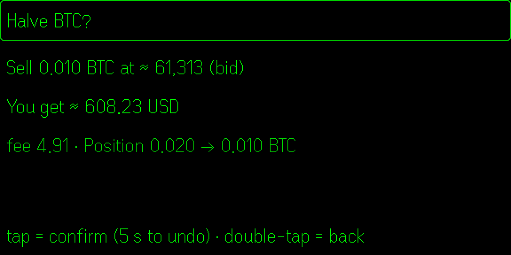
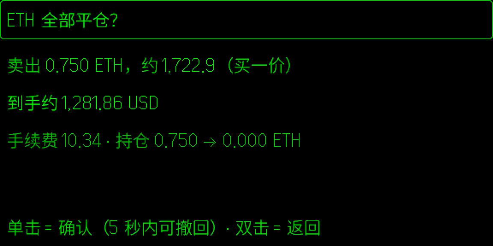
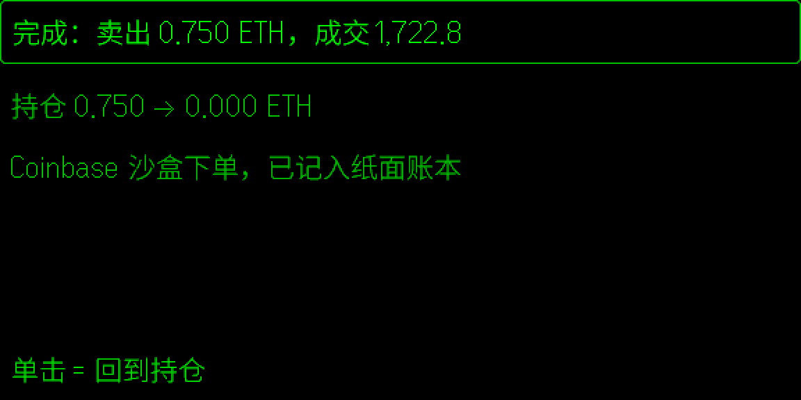
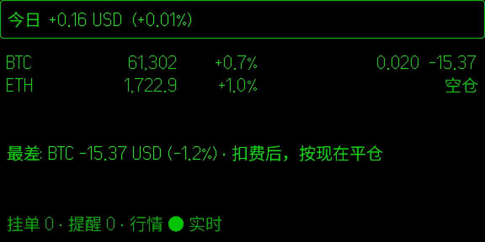
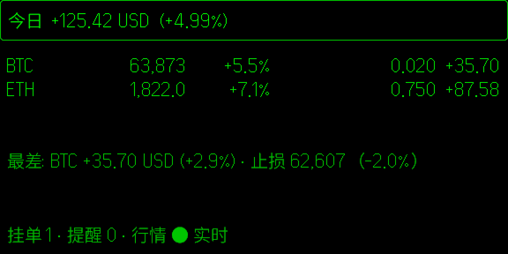
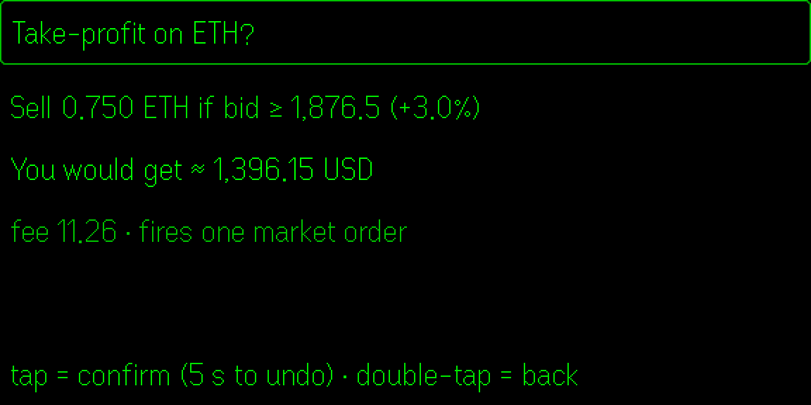
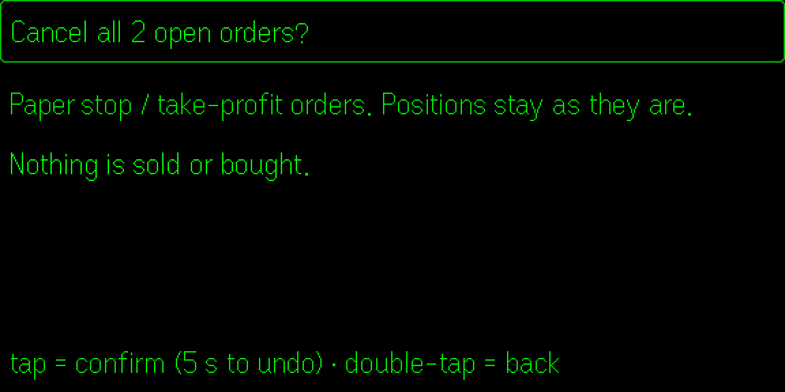
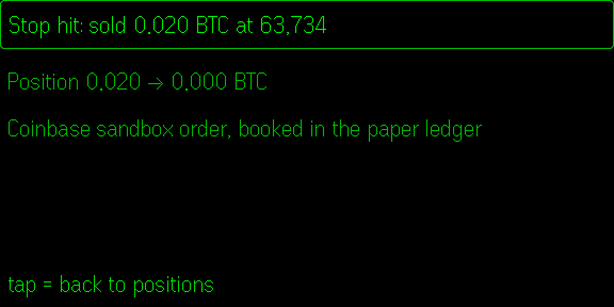

# RiskDesk for Even Realities G2

See your crypto risk on the glasses, act with one tap, and get 5 seconds to take it back.

Heads Up: Even Realities G2 hackathon, track 03 Exchanges & Stocks (Coinbase).


## What works today (Day 1-3a)

- **Live Coinbase prices** over the public Advanced Trade WebSocket (`ticker` + `heartbeats`, no API key).
  The backend sends the glasses at most one update per second, and only when a number on screen would change.
- **Never shows an old price as live.** No heartbeat for 3 s, a dropped message (sequence gap), or a lost backend
  connection all switch the 24h column to `old`, dim the prices and say so in the footer.
- **Paper portfolio with honest PnL**: FIFO lots, 0.8% fee on every fill, positions marked at the price you could
  actually exit at (long -> best bid, short -> best ask) minus the exit fee. Day PnL runs from 00:00 UTC.
- **Demo portfolio priced at real history**: the seed fills (0.02 BTC bought 70 h ago, 0.75 ETH in two buys) are
  priced at the real Coinbase 1-minute candle of that moment, fetched at startup. Nothing on screen is made up.
- English and Chinese (double-tap toggles).

| Live | Backend lost |
|---|---|
|  |  |

Screenshots are the simulator's 576x288 glasses buffer, drawn green-on-black at 2x.

### One-tap actions with a 5-second undo (Day 2)

Open the glasses' context menu on the positions page: **Halve / Close / Stop-loss / Take-profit** for BTC and ETH,
**Cancel all orders**, and language: 10 items, the SDK maximum.

1. **Confirm page** - what will be sold, at roughly which price (bid for a sell, ask for a buy), the fee, what you get,
   and the position before -> after. Every number comes from the backend; the glasses only lay it out.
   Tap = confirm, double-tap = back.
2. **Undo page** - nothing has been sent yet. Five dots count down once per second; tap anywhere to undo.
3. **Result page** - after the window one Coinbase Advanced Trade *Create Order* request goes out
   (public sandbox by default) with `client_order_id` = the action id, so a double tap or a retry can never create two orders.
   The fill is booked in the paper ledger at the bid/ask *at execution time*, and the page says it was a sandbox order.

Safety checks at confirm time: a preview older than 30 s, or whose price moved more than 1%, is refused
("look again") instead of executed. Only one action can be armed at a time. The context menu exists only on the
positions page, so it can never open on top of a confirm or undo page.

| Context menu | Confirm | Undo window |
|---|---|---|
|  |  |  |

| Close ETH (zh) | Filled (sandbox) | Back on positions: ETH flat, day PnL updated |
|---|---|---|
|  |  |  |

A confirm on a stale preview: 

All of the above are simulator screenshots of real runs driven by the simulator's automation API
(context_menu / down / click) against the live Coinbase feed; the backend log of the same run:

```
action 6054f04e halve BTC-USD: proposed
action 6054f04e halve BTC-USD: armed
action 6054f04e halve BTC-USD: undone
action 7a7ec95f close ETH-USD: proposed
action 7a7ec95f close ETH-USD: armed
action 7a7ec95f close ETH-USD: sending
filled SELL 0.75 ETH-USD @ 1722.8
action 7a7ec95f close ETH-USD: filled
```

### Stop-loss, take-profit, cancel all (Day 2b)

The same confirm -> 5 s undo flow places **paper resting orders**, watched by the backend against the live quote:

- **Stop-loss** rests 2% below the current exit price (long) / above it (short); **take-profit** 3% on the other side
  (`STOP_PCT` / `TAKE_PCT` to change). The confirm page says which side of the book triggers it, the distance in %,
  and what the fill would pay after fees. One stop and one take per position; a new one says what it replaces.
- Triggers use the price you can actually exit at: the **bid** for a long, the **ask** for a short. A stale or
  missing quote never triggers. When one fires, the backend sends one market IOC order (same path as a manual close),
  books the fill at the *execution-time* bid/ask, and drops the other order of that position (one-cancels-other).
  The glasses show "Stop hit: sold ... at ..." by themselves.
- Halving a position shrinks its resting orders to the new size; closing it drops them. A manual close that was
  armed when a stop fired is refused ("position already closed") instead of opening a short.
- **Cancel all orders** shows how many it will cancel and that positions stay as they are.
- The positions page footer counts open orders, and the worst-position line shows the distance to its stop.
- Resting orders are saved in `server/data/orders.json` and re-fitted to the ledger on restart.

Why paper and not exchange stops: the public Coinbase sandbox returns canned responses and keeps no order book,
so a native stop placed there could never trigger. With production keys the same orders could be sent as
Advanced Trade `stop_limit_stop_limit_gtc` / bracket orders; that is not wired up in this hackathon build.

| Menu (10 items) | Stop-loss confirm (zh) | Undo window |
|---|---|---|
|  |  |  |

| Positions: 1 open order, distance to stop | Take-profit confirm | Cancel all |
|---|---|---|
|  |  |  |

A stop firing by itself (backend started with `STOP_PCT=0.00005` so the live BTC bid crosses it within seconds):



```
action 1ed5ccd3 stop BTC-USD: proposed
action 1ed5ccd3 stop BTC-USD: armed
action 1ed5ccd3 stop BTC-USD: placed
action 2e5017e7 stop BTC-USD: sending
filled SELL 0.02 BTC-USD @ 63734.19
action 2e5017e7 stop BTC-USD: filled
```

In an earlier run the stop was at 64,306.64 and the fill was booked at 64,310.63: the bid crossed the trigger and
bounced back during the sandbox round trip. The ledger keeps the execution-time price, not the trigger.

### Voice command parser (Day 3, first part)

`server/src/command.ts` turns a faster-whisper transcript (Chinese or English) into an intent, a coin and prices.
It never sends anything on its own: a parsed command can only open the same confirm page the menu opens.
Design rule: a wrong *different write* (for example a bracket heard as a lone stop) is the one error that is not
allowed; when half a sentence is misheard the parser answers `unknown` and the glasses ask you to say it again.

Tested on 108 spoken commands (`server/test/fixtures/voice-108.json`, made on 2026-11-21 before the hackathon:
Windows TTS at 16 kHz, fed in 100 ms chunks like the glasses mic, transcribed by faster-whisper int8 on CPU;
24 of them are a held-out set that was never looked at while writing the rules):

| Setting (what ships in bold) | right first time | pick the coin on the confirm page | asked to repeat | visible mistake on confirm page | dangerous |
|---|---|---|---|---|---|
| **Chinese, small + domain prompt** (54 clips) | 51 | 1 | 1 | 1 | **0** |
| **English, base + domain prompt** (54 clips) | 48 | 5 | 0 | 1 | **0** |
| all 8 model / prompt settings (312 clips) | | | | | **0** |

All 108 reference sentences parse exactly. Whisper output it copes with: `六万五` / `6万5` / `5,9500` / `6萬`
(traditional), misheard coins (`以太房`, `earth`), "fourteen fifty" = 1,450, "sixteen eighty point five", "60k",
"cell" for "sell".

## Run it

Needs Node 22.18+ (TypeScript runs natively, the backend has zero dependencies).

```bash
cd server && npm start            # http://127.0.0.1:8787  (/api/state, /api/stream, POST /api/preview|confirm|undo|dismiss)
                                  # preview kinds: halve, close, stop, take (with product) and cancelAll
cd app && npm install && npm run dev
npx evenhub-simulator http://127.0.0.1:5173/
```

Tests: `cd server && npm test` (ledger, feed, actions, resting orders: 35 tests) and `cd app && npm test` (layout, pages, menu: 17 tests).

The demo portfolio is stored in `server/data/fills.json` (resting orders in `orders.json`); delete them to re-seed.

## How PnL is computed

- Unrealized = qty x (exit price - average entry) - exit fee, with exit price = best bid for longs, best ask for shorts.
- Day PnL = equity now - equity at 00:00 UTC. Equity = cash + what open positions would fetch after fees.
  The 00:00 UTC mark is the open of that minute's public Coinbase candle.
- Percent base = exposure held at 00:00 UTC (at the open price) + cost of positions opened today.
- If any held product has no live quote, day PnL shows `—`, never a stale or zero number.

## Display rules (measured in the simulator)

- A tap arrives as `CLICK_EVENT` = 0, the protobuf default, so `eventType` is usually omitted: the simulator sends `{sysEvent: {eventSource: 1}}`. Treat a missing type as a click.

- Line height 28 px; a text container needs `lines x 28 + 2 x padding` (+2 with a border) or a scrollbar appears.
- `textContainerUpgrade` changes text and brightness but never size, so the page geometry is fixed and does not depend on data.
- The font is proportional and containers have no alignment: numbers are right-aligned by left-padding with normal
  spaces, using the firmware glyph widths from `@evenrealities/pretext`. The firmware font has no thin space (U+2009
  logs `glyph not found` and falls back to a placeholder that real glasses may draw), so only the 5 px space is used,
  and each column picks the target edge where its lines agree best (3 lines in 5 px steps: right edges within 3 px, the best possible).
- Brightness levels 1 and 3 render only ~180 vs ~230, too subtle to carry a warning alone, hence the explicit `old` marker.

## Built during the hackathon

Code in this repository was written from 2026-11-23 08:00 UTC onward. Before that I only had research notes
(SDK/simulator behaviour, the display measurements above, Coinbase API tests, and a speech-command test set);
none of that pre-hackathon spike code is used here. Written with AI assistance (Claude), reviewed and tested by me.

## Roadmap for the week

1. ~~Confirm page + 5-second undo + sandbox orders for halve / close~~ (done Day 2); ~~cancel all, stop, take-profit~~ (Day 2b); next: price alerts.
2. Hold-to-talk voice commands (local faster-whisper) that only ever produce a confirm page: ~~parser + 108-clip regression~~ (Day 3a); next: mic -> STT service -> confirm page, price sanity check against the live price.
3. Risk page: distance to stop / expiry for Coinbase futures, 24h sparkline.
4. Demo video.

## License

MIT
