# RiskDesk for Even Realities G2

See your crypto risk on the glasses, act with one tap, and get 5 seconds to take it back.

Heads Up: Even Realities G2 hackathon, track 03 Exchanges & Stocks (Coinbase).

**Try it in your browser, nothing to install: https://vigohan95.github.io/riskdesk-g2/**
The page runs the unchanged glasses app and the unchanged desk on live Coinbase prices (orders there are paper fills;
voice is typed and goes through the same parser and safety checks). Build it yourself with `cd app && npm run web:build`.

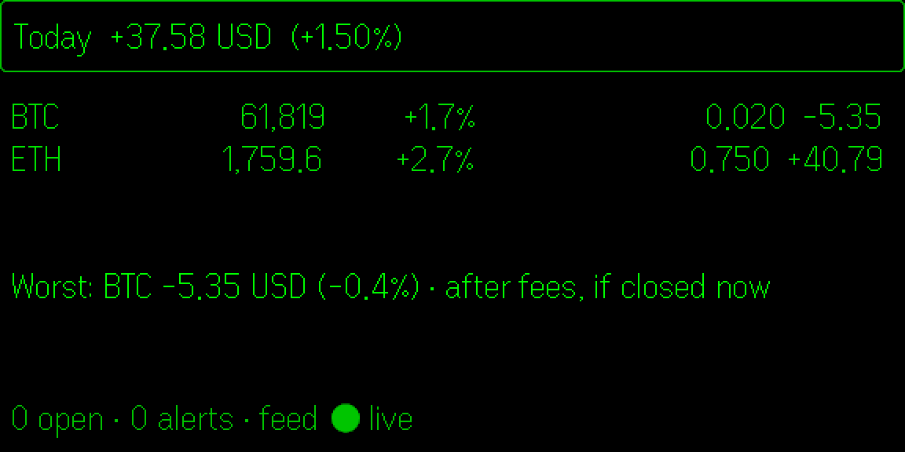

## What works (built 2026-11-23 to 11-27)

- **Live Coinbase prices** over the public Advanced Trade WebSocket (`ticker` + `heartbeats`, no API key).
  The backend sends the glasses at most one update per second, and only when a number on screen would change.
- **Never shows an old price as live.** No heartbeat for 3 s, a dropped message (sequence gap), or a lost backend
  connection all switch the 24h column to `old`, dim the prices and say so in the footer.
- **Paper portfolio with honest PnL**: FIFO lots, 0.8% fee on every fill, positions marked at the price you could
  actually exit at (long -> best bid, short -> best ask) minus the exit fee. Day PnL runs from 00:00 UTC.
- **Demo portfolio priced at real history**: the seed fills (0.02 BTC bought 70 h ago, 0.75 ETH in two buys) are
  priced at the real Coinbase 1-minute candle of that moment, fetched at startup. Nothing on screen is made up.
- English and Chinese (double-tap toggles).

| Live | Backend lost |
|---|---|
| 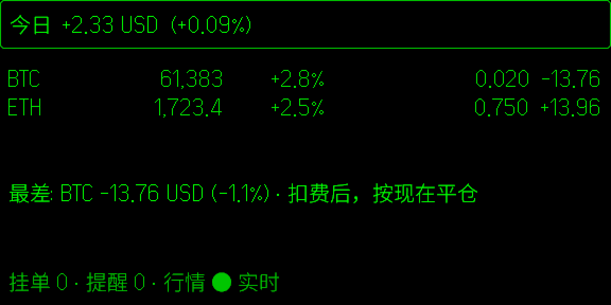 | 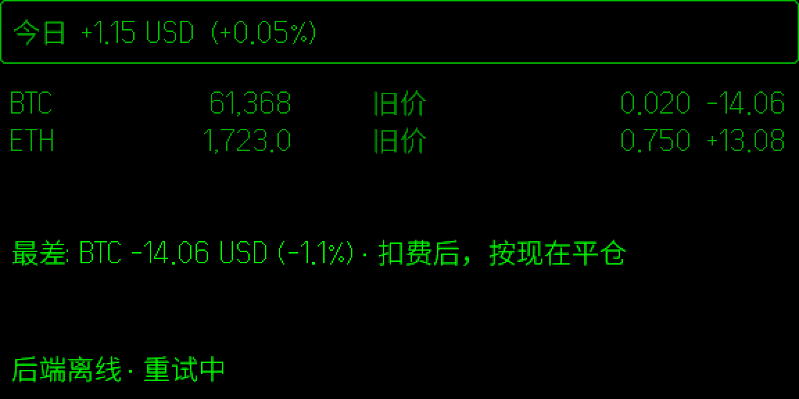 |

Screenshots are the simulator's 576x288 glasses buffer, drawn green-on-black at 2x.

### One-tap actions with a 5-second undo (Day 2)

Open the glasses' context menu on the positions page: **Halve / Close / Stop-loss / Take-profit** for BTC and ETH,
**Cancel all orders**, and language: 10 items, the SDK maximum.

The order follows your positions, so the first item is the thing to do now: a holding within 1% of its stop
puts **Halve** first; a holding with no stop puts **Stop-loss** first (losing ones before winning ones); a protected
winner with no target puts **Take-profit** first. The most urgent symbol comes first. Item IDs do not depend on the
order, so a click always does what its label says, and a reorder is sent to the glasses at most every 20 s
(each menu change redraws the page).

1. **Confirm page** - what will be sold, at roughly which price (bid for a sell, ask for a buy), the fee, what you get,
   and the position before -> after. Every number comes from the backend; the glasses only lay it out.
   Tap = confirm, double-tap = back.
2. **Undo page** - nothing has been sent yet. Five dots count down once per second; tap anywhere to undo.
3. **Result page** - after the window one Coinbase Advanced Trade *Create Order* request goes out
   (public sandbox by default) with `client_order_id` = the action id, so a double tap or a retry can never create two orders.
   The fill is booked in the paper ledger at the bid/ask *at execution time*, and the page says it was a sandbox order.
   The last line is an **after-action receipt**: the same downside number before -> after, at the live exit price.
   Under a stop it is the money lost if the stop fires (`If stop 60,350 hits: −24.01 → −12.00 USD` after a halve;
   `no floor → −22.68 USD` after setting a first stop); with no stop it is the last 24 h range on the position's size
   (`No stop · 24h range on the position 42.62 → 21.31 USD`). Spot has no liquidation price, so this is the number an action changes.

Safety checks at confirm time: a preview older than 30 s, or whose price moved more than 1%, is refused
("look again") instead of executed. Only one action can be armed at a time. The context menu exists only on the
positions page, so it can never open on top of a confirm or undo page.

| Context menu | Confirm | Undo window |
|---|---|---|
| 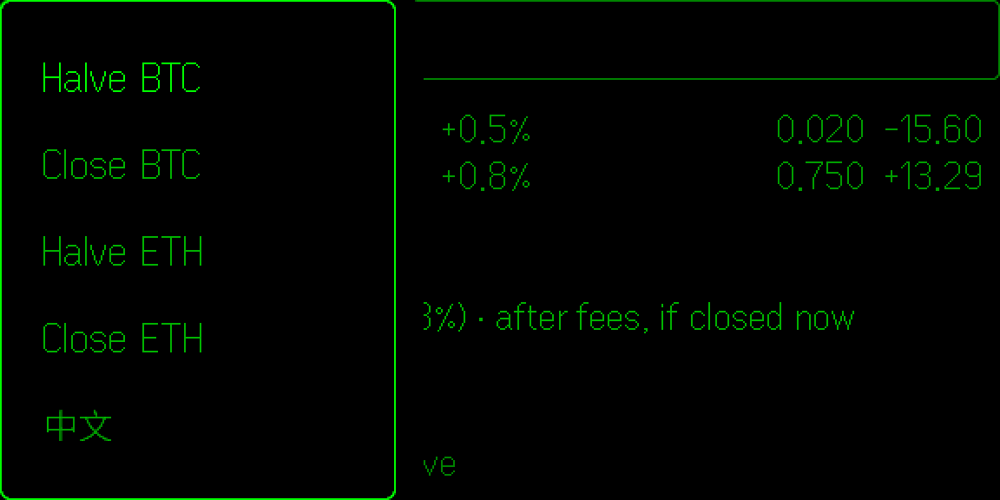 |  |  |

| Close ETH (zh) | Filled (sandbox) | Back on positions: ETH flat, day PnL updated |
|---|---|---|
|  |  |  |

A confirm on a stale preview: 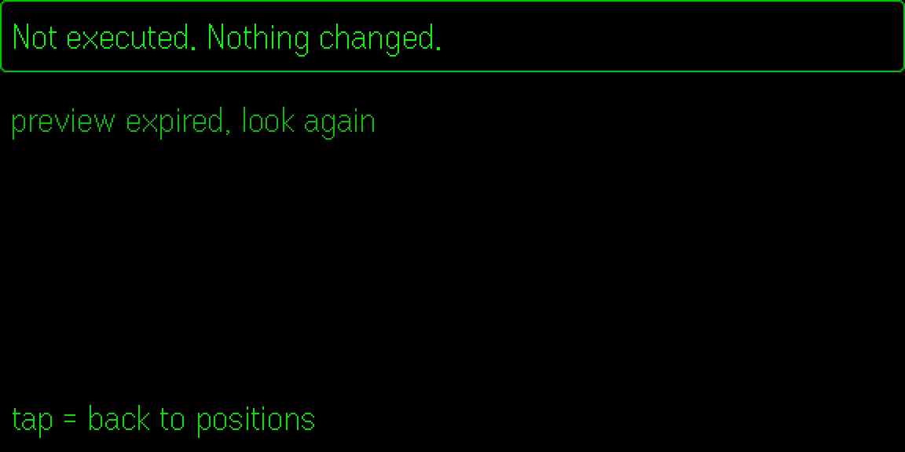

All of the above are simulator screenshots of real runs driven by the simulator's automation API
(context_menu / down / click) against the live Coinbase feed; the backend log of the same run:

```
action 6054f04e halve BTC-USD: proposed
action 6054f04e halve BTC-USD: armed
action 6054f04e halve BTC-USD: undone
action 7a7ec95f close ETH-USD: proposed
action 7a7ec95f close ETH-USD: armed
action 7a7ec95f close ETH-USD: sending
filled SELL 0.75 ETH-USD @ 1722.8
action 7a7ec95f close ETH-USD: filled
```

### Stop-loss, take-profit, cancel all (Day 2b)

The same confirm -> 5 s undo flow places **paper resting orders**, watched by the backend against the live quote:

- **Stop-loss** rests 2% below the current exit price (long) / above it (short); **take-profit** 3% on the other side
  (`STOP_PCT` / `TAKE_PCT` to change). The confirm page says which side of the book triggers it, the distance in %,
  and what the fill would pay after fees. One stop and one take per position; a new one says what it replaces.
- Triggers use the price you can actually exit at: the **bid** for a long, the **ask** for a short. A stale or
  missing quote never triggers. When one fires, the backend sends one market IOC order (same path as a manual close),
  books the fill at the *execution-time* bid/ask, and drops the other order of that position (one-cancels-other).
  The glasses show "Stop hit: sold ... at ..." by themselves.
- Halving a position shrinks its resting orders to the new size; closing it drops them. A manual close that was
  armed when a stop fired is refused ("position already closed") instead of opening a short.
- **Cancel all orders** shows how many it will cancel and that positions stay as they are.
- The positions page footer counts open orders, and the worst-position line shows the distance to its stop.
- Resting orders are saved in `server/data/orders.json` and re-fitted to the ledger on restart.

Why paper and not exchange stops: the public Coinbase sandbox returns canned responses and keeps no order book,
so a native stop placed there could never trigger. With production keys the same orders could be sent as
Advanced Trade `stop_limit_stop_limit_gtc` / bracket orders; that is not wired up in this hackathon build.

| Menu (10 items) | Stop-loss confirm (zh) | Undo window |
|---|---|---|
| 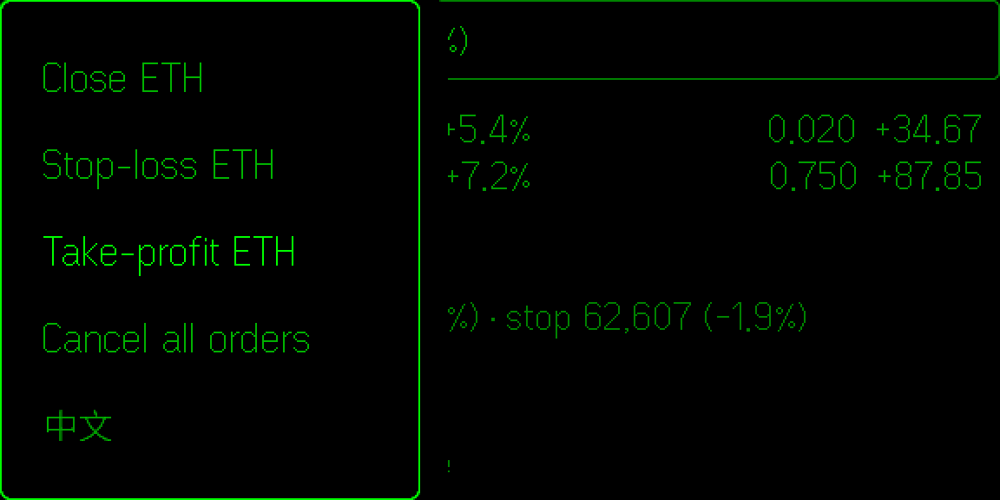 | 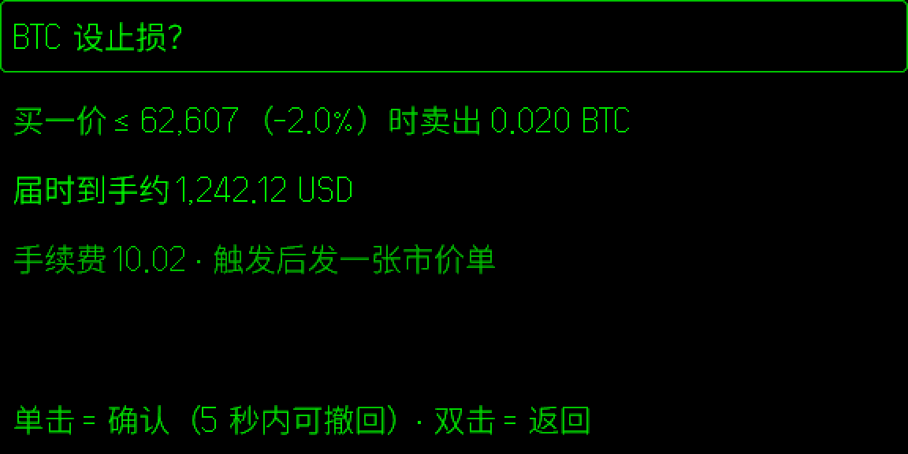 | 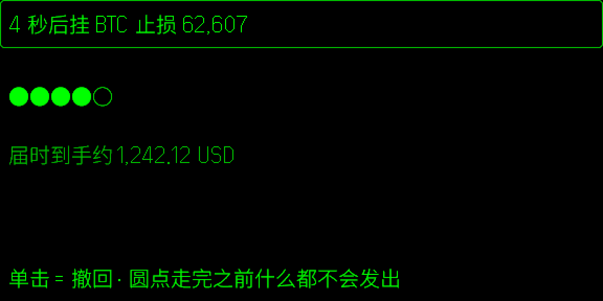 |

| Positions: 1 open order, distance to stop | Take-profit confirm | Cancel all |
|---|---|---|
|  |  |  |

A stop firing by itself (backend started with `STOP_PCT=0.00005` so the live BTC bid crosses it within seconds):


```
action 1ed5ccd3 stop BTC-USD: proposed
action 1ed5ccd3 stop BTC-USD: armed
action 1ed5ccd3 stop BTC-USD: placed
action 2e5017e7 stop BTC-USD: sending
filled SELL 0.02 BTC-USD @ 63734.19
action 2e5017e7 stop BTC-USD: filled
```

In an earlier run the stop was at 64,306.64 and the fill was booked at 64,310.63: the bid crossed the trigger and
bounced back during the sandbox round trip. The ledger keeps the execution-time price, not the trigger.

### Voice command parser (Day 3, first part)

`server/src/command.ts` turns a faster-whisper transcript (Chinese or English) into an intent, a coin and prices.
It never sends anything on its own: a parsed command can only open the same confirm page the menu opens.
Design rule: a wrong *different write* (for example a bracket heard as a lone stop) is the one error that is not
allowed; when half a sentence is misheard the parser answers `unknown` and the glasses ask you to say it again.

Tested on 108 spoken commands (`server/test/fixtures/voice-108.json`, made on 2026-11-21 before the hackathon:
Windows TTS at 16 kHz, fed in 100 ms chunks like the glasses mic, transcribed by faster-whisper int8 on CPU;
24 of them are a held-out set that was never looked at while writing the rules):

| Setting (what ships in bold) | right first time | no coin heard: asked to name it | asked to repeat | visible mistake on confirm page | dangerous |
|---|---|---|---|---|---|
| **Chinese, small + domain prompt** (54 clips) | 51 | 1 | 1 | 1 | **0** |
| **English, base + domain prompt** (54 clips) | 48 | 5 | 0 | 1 | **0** |
| all 8 model / prompt settings (312 clips) | | | | | **0** |

All 108 reference sentences parse exactly. Whisper output it copes with: `六万五` / `6万5` / `5,9500` / `6萬`
(traditional), misheard coins (`以太房`, `earth`), "fourteen fifty" = 1,450, "sixteen eighty point five", "60k",
"cell" for "sell".

### Hold to talk (Day 3, second part)

Long-press on the positions page, say the command, release. The glasses mic streams 16 kHz PCM to the backend;
`stt/` (faster-whisper on your own machine, no key, audio never leaves it) transcribes it; the parser above turns it
into an intent; `server/src/voice.ts` decides what that may become. A voice command can only ever produce:

- the **same confirm page** the menu opens (halve, close, stop-loss / take-profit at the price you said, cancel all,
  or both legs at once: see *Stop + take-profit in one sentence* below), with one more line: what was heard. Nothing moves until you tap, and the 5-second undo still applies;
- a **paper price alert** ("alert me if ETH drops below 1650"), shown with what was heard; one tap removes it again;
- or a **refusal that says why**, for example:
  - a price off by an order of magnitude (五千九 instead of 五万九): more than 3x or less than 1/3 of the live price;
  - a stop above the bid (it would fire at once), an alert that is already crossed;
  - no coin heard (never guessed: Whisper hears "ETH" as "F" or "earth");
  - "buy" / "sell": voice only reduces risk, it never opens or adds to a position.

A price more than 20% from the market is allowed but the heard line turns bright and says so.

| Listening | Confirm page from voice | Set, tap to see positions |
|---|---|---|
| 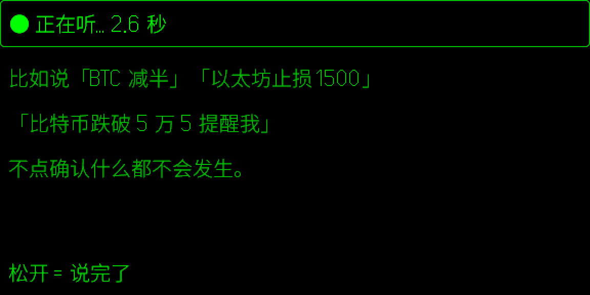 | 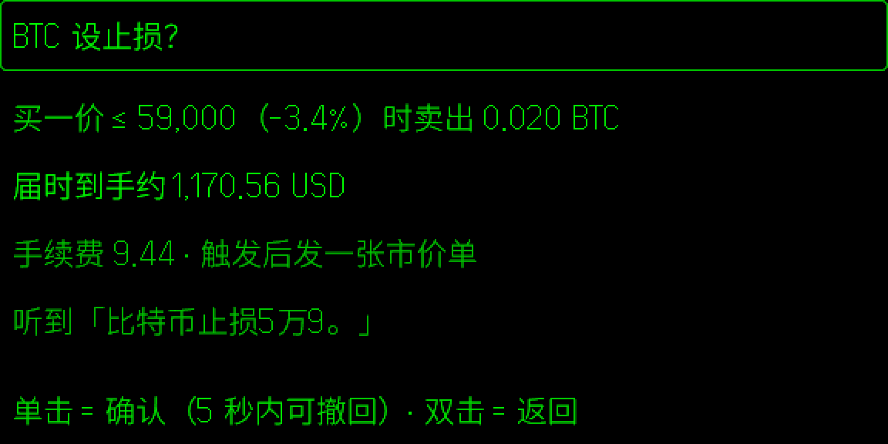 | 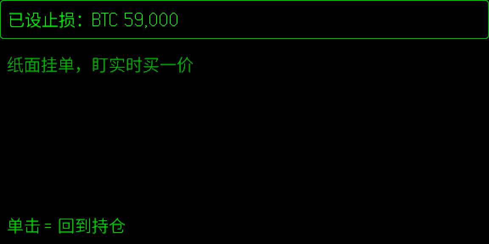 |
| 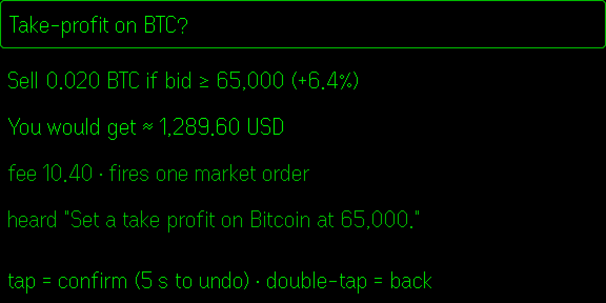 | 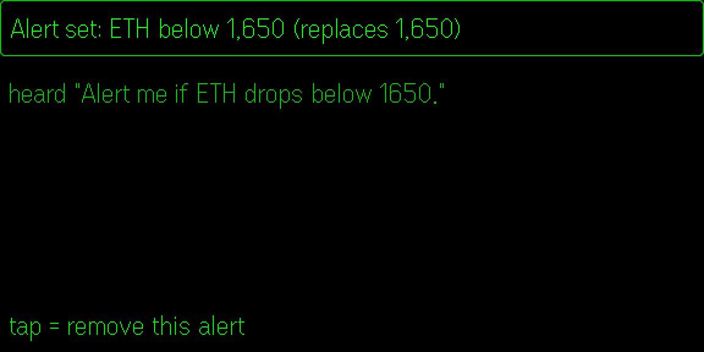 | 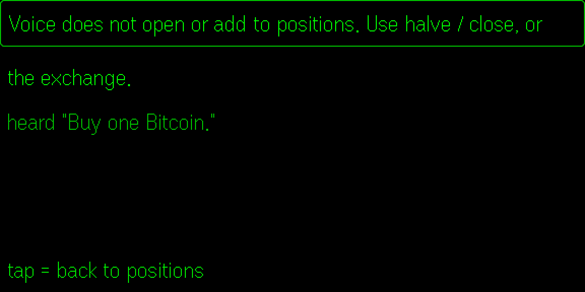 |
| 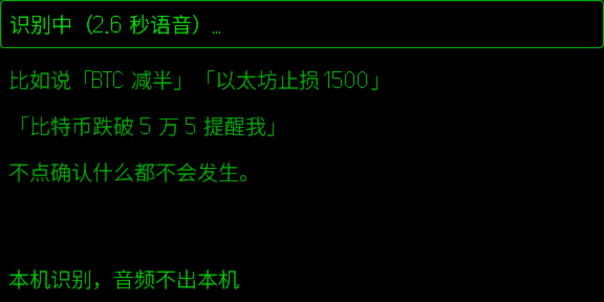 | 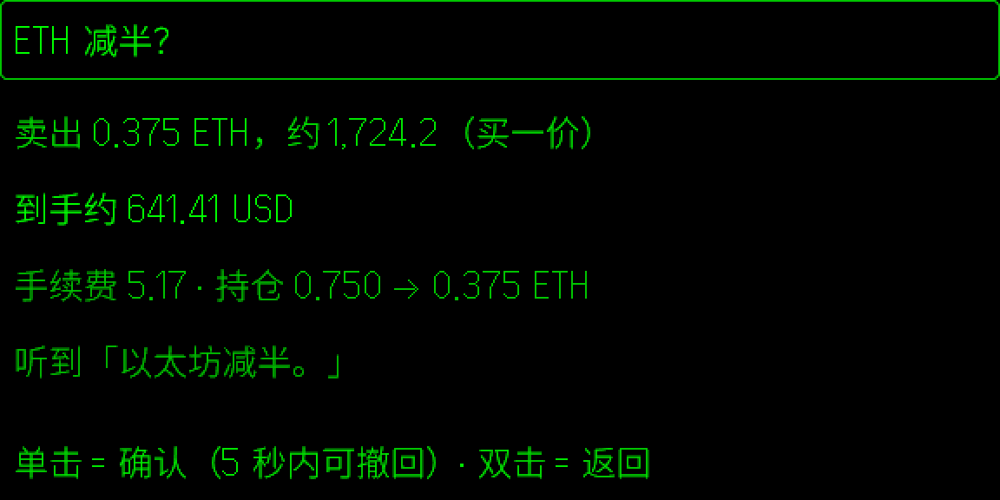 | 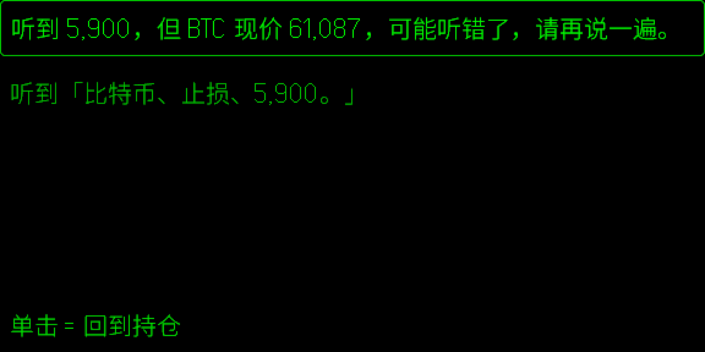 |

**The simulator has no microphone**, so these runs feed a recorded WAV (Windows TTS, 16 kHz mono) into the open
recording through a dev-only endpoint (`DEV_INJECT=1`, `POST /api/dev/inject`), cut into the same 3200-byte chunks the
glasses send. Everything after the mic is the real path: long press and release come from the simulator, the
transcript from faster-whisper, the plan from `voice.ts`, the page from the backend state. Measured on this machine
(16-core CPU, int8): English (base) 0.7-1.0 s per command, Chinese (small) 2.5-3.1 s.

Same 312 real Whisper transcripts as above, now through the whole plan (`server/test/voice.test.ts`): no plan acts on
a different coin, direction, kind or order price than the one spoken. Three alerts keep a misheard number
(五万八 -> 51,800, 一千六百零五 -> 1,650, "1525.5" -> 1,500); an alert moves no money and is shown with the transcript
and a one-tap remove. With the shipping settings, 34 of 36 actionable Chinese commands and 33 of 36 English ones
give exactly the plan the original sentence gives.

### Stop + take-profit in one sentence (Day 4b)

"BTC stop 58k, take profit 64k" / 「比特币止损五万八，止盈六万四」 opens **one** confirm page with both legs. Each leg
shows its side of the book, distance from the exit price and the money it would bring; the stop leg is the brightest
line (it is the loss being capped). One tap, the same 5-second undo, then both rest in the paper book as
one-cancels-other: whichever fires first sends one market order and drops the other.

| Confirm (zh, replaces both old legs) | Undo window | Both set |
|---|---|---|
| 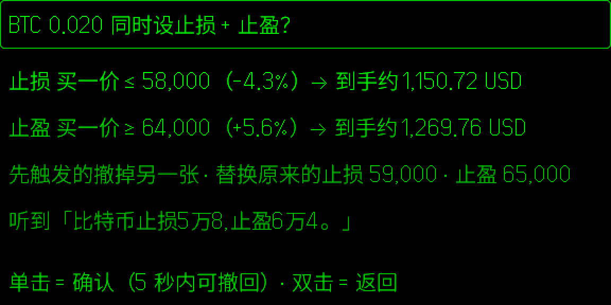 | 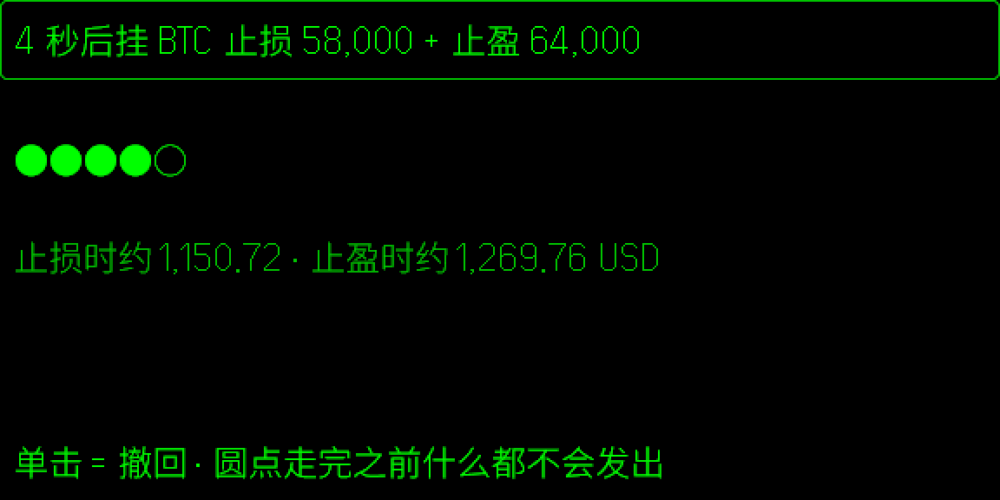 | 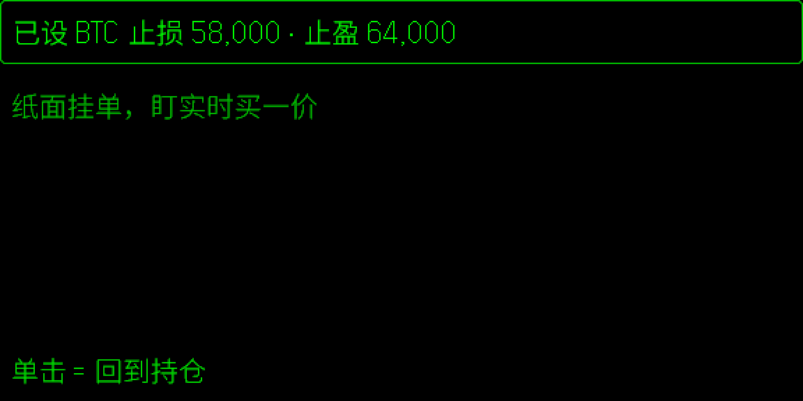 |
| 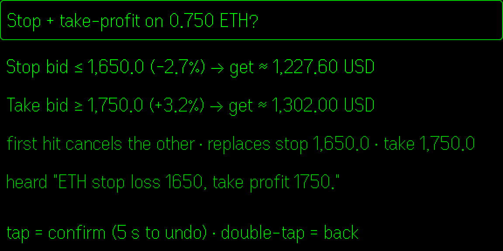 | 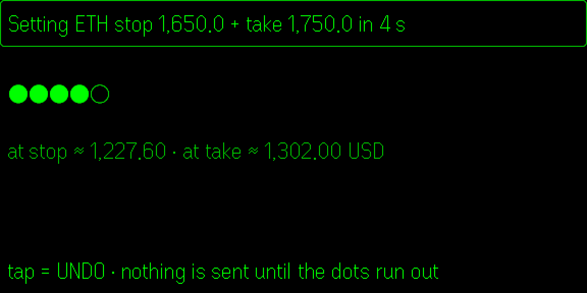 | 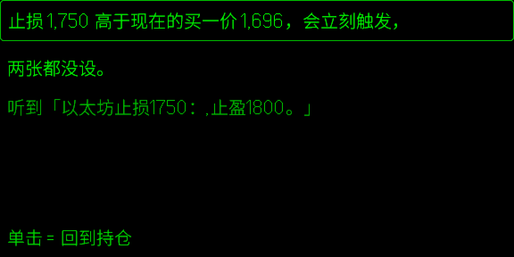 |

A bracket is placed whole or not at all:

- **exactly two prices** or it asks again. Real Whisper output for 「以太坊止损两千七，止盈三千一」 was
  `以太坊止損2000期,只迎3000一` (three numbers): refused, instead of guessing which two were meant;
- **every single-leg check on both legs** (order of magnitude, stop on the losing side, take-profit on the winning
  side); if either fails nothing is proposed and the page says "neither leg set" (bottom-right shot: an ETH stop
  above the bid);
- the two numbers are assigned by which word was said first ("take profit 1750, stop loss 1500" works too), never by
  which number is bigger;
- the desk re-checks both legs against the live bid/ask when pricing the page (`ActionDesk.preview('bracket', ...)`)
  and when the 5 s run out (position changed: nothing placed).

The menu stays at its 10-item SDK limit, so brackets are voice only. Of the 24 bracket transcripts among the 312,
7 now open exactly the spoken bracket (both prices); the other 17 are refused (on the recording day most of those
stops were above the price, and one was garbled to 10005 / 17005); none places a different price or a single leg.

### Risk page (Day 4a)

Tap the positions page (its footer says `tap = risk` whenever something is held) to get one page per position:
where the stop sits, what it costs if it fires, and how it compares with what the market actually did in the last
24 hours. Tap again for the next position, double-tap to go back. Voice still works from this page.

| BTC: stop and take-profit set | ETH: no stop |
|---|---|
| 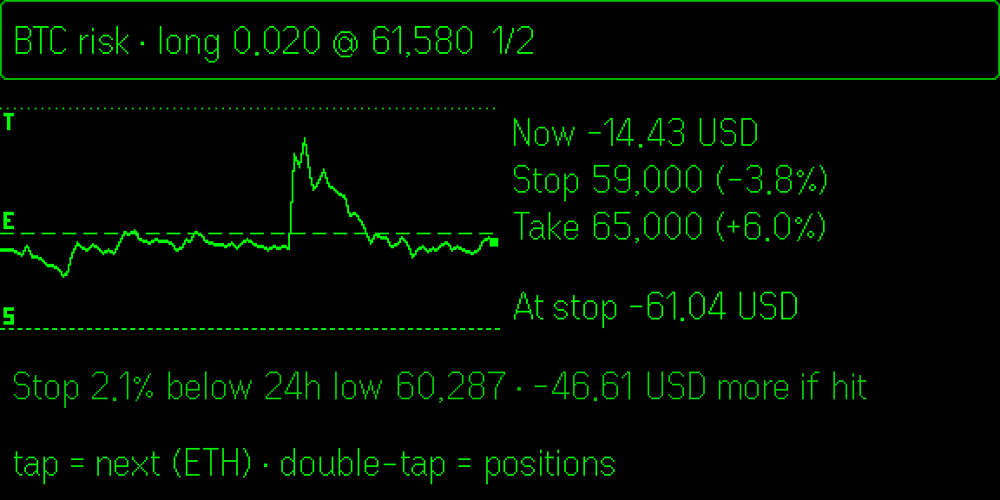 | 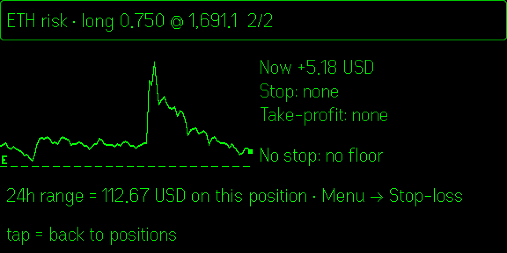 |
| 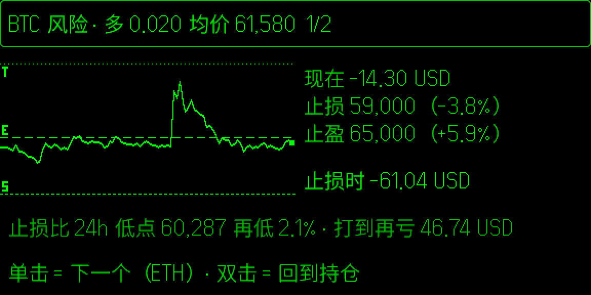 | 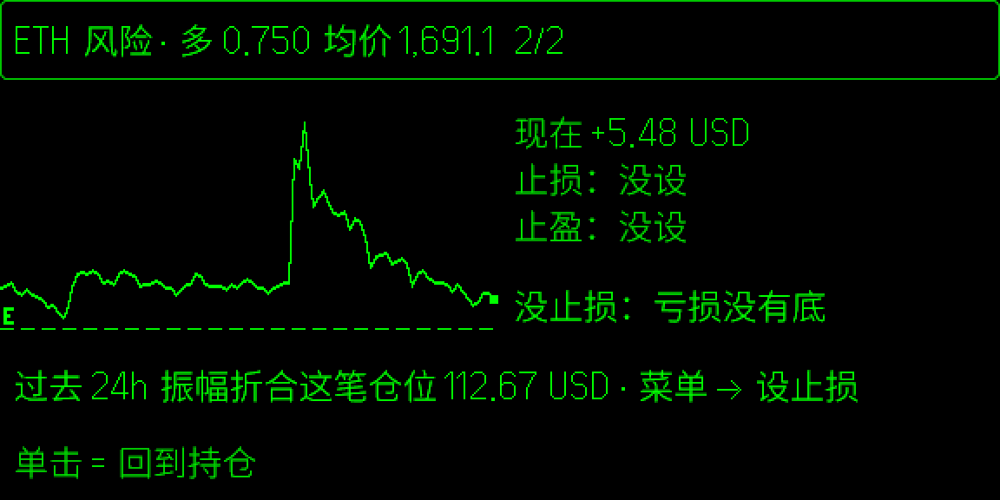 |

- **Chart** (left, an image container at the SDK's 288x144 maximum): the last 24 h of Coinbase's public 15-minute
  candles plus the live price (the square). Dashed levels are tagged **S** stop (short dashes, brightest),
  **E** average entry (long dashes), **T** take-profit (dotted). A level too far away to fit without flattening the
  price line is pinned to the top or bottom edge in a sparse pattern, meaning "off the chart that way".
  The chart is drawn as grey pixels in `app/src/risk.ts`, encoded to PNG through a canvas, and re-sent only when it
  would look different (at most every 15 s; each send costs ~100 ms on the glasses).
- **Money** (right): PnL now (after the exit fee), stop and take-profit with their distance from the exit price,
  and **at stop**: the whole position's PnL if the stop fills at its trigger, fee included.
- **The line under the chart** says how the stop compares with the last 24 h: how far below the 24 h low it is
  (above the high for a short) and how much more is lost from here if it is hit. If the stop is *inside* the last
  24 h range, the last day's moves alone would have hit it, and the line is drawn at full brightness. With no stop,
  it shows what the last 24 h range was worth on this position, and where in the menu to set one.
- All of it is computed by the server (`server/src/risk.ts`, same fee and exit-price conventions as the ledger) and
  only sent while the feed is live: no distance is ever measured from a frozen price.

Coinbase's futures data (expiry, funding, margin rates) is also readable without a key
(`/api/v3/brokerage/market/products?product_type=FUTURE`), but the demo portfolio holds spot, so the page shows
nothing about contracts it does not hold.

## Demo video: scripted, not staged

The demo video is recorded by a script, so anyone can re-record it and get the same story on today's prices:
`demo/record.py` drives the simulator through its automation API (tap, double tap, menu, long press / release) and
saves the 576x288 glasses buffer every time it changes; `demo/compose.py` lays those frames out at 1080p with the
gesture being pressed and a caption, and puts each voice clip on the audio track at the moment it was fed in.

```
# backend with DEV_INJECT=1, STT service, app and simulator running as in "Run it" (simulator: --automation-port 9898)
python demo/record.py --story en --out demo/run-en      # or --story zh (start the simulator with &lang=zh)
python demo/compose.py demo/run-en demo/riskdesk-en.mp4 # needs Pillow + ffmpeg
# the submitted cut: hold the risk page 2.5 s longer, then the bracket order again in the other language
python demo/compose.py demo/run-en demo/riskdesk-en.mp4 --hold 41:2.5 --append demo/run-zh:15.8:38.0
```

`--hold` only repeats a simulator frame (never inside a voice clip); `--append` plays a stretch of a second run behind a
short title card. Nothing is drawn onto the glasses picture.

Story (about 93 s of glasses time): PnL page -> tap -> BTC risk page with no stop -> hold and say "Bitcoin stop loss
fifty-eight thousand, take profit sixty-four thousand" -> one confirm page for both legs -> tap -> 5 s undo window ->
placed, with the receipt line (worst case if the stop hits) -> the risk page now draws S and T on the 24h chart -> menu, whose first item is the suggested action
(BTC is bracketed, ETH has no stop, so "Stop-loss ETH" is on top) -> tap, confirm: ETH stop placed, receipt "no floor -> -25 USD" -> menu again,
re-ordered -> halve BTC -> confirm -> tap again within 5 s: undone, nothing sent -> "ETH stop at one sixty-five" refused as a misheard magnitude -> "Buy one bitcoin" refused
(voice never opens positions). The voice clips in `demo/clips/` are Windows TTS, 16 kHz mono, because the simulator
has no microphone; everything after the mic is the real path, including local Whisper.

## Run it

Needs Node 22.18+ (TypeScript runs natively, the backend has zero dependencies).

```bash
cd server && npm start            # http://127.0.0.1:8787  (/api/state, /api/stream, POST /api/preview|confirm|undo|dismiss)
                                  # preview kinds: halve, close, stop, take, bracket (with product) and cancelAll
cd stt && python -m pip install -r requirements.txt && python server.py   # http://127.0.0.1:8788, loads base + small
cd app && npm install && npm run dev
npx evenhub-simulator http://127.0.0.1:5173/
```

Voice in the simulator (no mic): start the backend with `DEV_INJECT=1`, long-press in the simulator, then
`curl -X POST --data-binary @command.wav http://127.0.0.1:8787/api/dev/inject` (16 kHz mono 16-bit WAV) and release.

Tests: `cd server && npm test` (ledger, feed, actions, resting orders, voice parser and plans, risk numbers, menu order, receipts: 67 tests) and `cd app && npm test` (layout, pages, menu, voice pages, bracket pages, risk page and chart: 35 tests). Checked on 2026-11-27 from a fresh clone (Node 24, npm 11): both suites pass, `npm run web:build` builds, the backend goes live on Coinbase within seconds.

### Install on a phone (.ehpk)

On real glasses the app runs inside the Even App's WebView on your phone, so `127.0.0.1` there means the phone,
not your computer. Run the backend where the phone can reach it and pack the app for that one address:

```bash
cd server && HOST=0.0.0.0 npm start                                   # plus the STT service on the same machine
cd app && RISKDESK_SERVER=http://192.168.1.20:8787 npm run pack       # -> riskdesk-0.1.0.ehpk
```

`npm run pack` type-checks, builds with that address baked in as the default server, writes it as the **only**
entry of the `network` whitelist (the package can reach nothing else), and runs `evenhub pack`. The backend already
answers with CORS headers, which the WebView enforces on top of the whitelist. Install through the Even App's
developer / beta-tester flow. Checked: the production build (`vite build` + `vite preview`, no `?server=` override)
renders the positions and risk pages in the simulator against live Coinbase data; not yet checked on physical G2
glasses.

The demo portfolio is stored in `server/data/fills.json` (resting orders in `orders.json`, alerts in `alerts.json`); delete them to re-seed.

## How PnL is computed

- Unrealized = qty x (exit price - average entry) - exit fee, with exit price = best bid for longs, best ask for shorts.
- Day PnL = equity now - equity at 00:00 UTC. Equity = cash + what open positions would fetch after fees.
  The 00:00 UTC mark is the open of that minute's public Coinbase candle.
- Percent base = exposure held at 00:00 UTC (at the open price) + cost of positions opened today.
- If any held product has no live quote, day PnL shows `—`, never a stale or zero number.

## Display rules (measured in the simulator)

- A tap arrives as `CLICK_EVENT` = 0, the protobuf default, so `eventType` is usually omitted: the simulator sends `{sysEvent: {eventSource: 1}}`. Treat a missing type as a click.

- Line height 28 px; a text container needs `lines x 28 + 2 x padding` (+2 with a border) or a scrollbar appears.
- `textContainerUpgrade` changes text and brightness but never size, so the page geometry is fixed and does not depend on data.
- The font is proportional and containers have no alignment: numbers are right-aligned by left-padding with normal
  spaces, using the firmware glyph widths from `@evenrealities/pretext`. The firmware font has no thin space (U+2009
  logs `glyph not found` and falls back to a placeholder that real glasses may draw), so only the 5 px space is used,
  and each column picks the target edge where its lines agree best (3 lines in 5 px steps: right edges within 3 px, the best possible).
- Brightness levels 1 and 3 render only ~180 vs ~230, too subtle to carry a warning alone, hence the explicit `old` marker.

## Built during the hackathon

Code in this repository was written from 2026-11-23 08:00 UTC onward. Before that I only had research notes
(SDK/simulator behaviour, the display measurements above, Coinbase API tests, and a speech-command test set);
none of that pre-hackathon spike code is used here. Written with AI assistance (Claude), reviewed and tested by me.

## Roadmap for the week

1. ~~Confirm page + 5-second undo + sandbox orders for halve / close~~ (done Day 2); ~~cancel all, stop, take-profit~~ (Day 2b); ~~price alerts~~ (Day 3b).
2. Hold-to-talk voice commands (local faster-whisper) that only ever produce a confirm page: ~~parser + 108-clip regression~~ (Day 3a); ~~mic -> STT service -> confirm page, price sanity checks, alerts~~ (Day 3b).
3. ~~Risk page: distance to stop, money at stop, 24 h chart with levels~~ (Day 4a); futures expiry / funding only if a futures position is added.
4. ~~Demo video~~ (Release v0.1.0, English and Chinese); ~~browser demo~~ (GitHub Pages); ~~menu ordered by what needs doing now, after-action receipts~~.

## License

MIT
